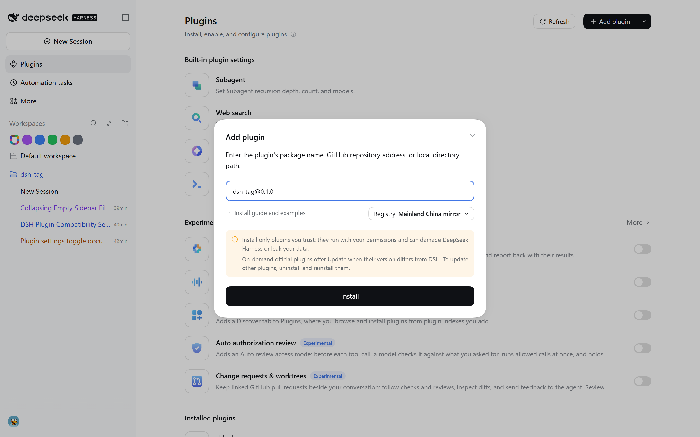

# dsh-tag

[English](README.md) | [中文](README.zh.md) | 日本語

DeepSeek Harness のセッションとワークスペースに色付きのタグを付けます。1 行に 1 つのタグ、タイトルはその色になり、ワークスペース一覧の上のバーでタグ絞り込みができます。

## インストール

プラグイン → プラグインを追加 → `dsh-tag@0.1.0`

## 使い方

- セッションまたはワークスペースの見出しを右クリック → **Tags** → 色を選択
- ワークスペースのタグはグループ全体を覆います
- ワークスペース一覧の上の色をクリックすると絞り込み。一致したグループは件数付きで開きます
- 設定 → タグ：名前変更、色変更、削除、追加。最大 10 個、色は重複不可
- 使わないときはフィルターバーを非表示にできます

API、色、互換性、開発: [docs/REFERENCE.md](https://github.com/ada87/dsh-tag/blob/main/docs/REFERENCE.md)。

MIT
