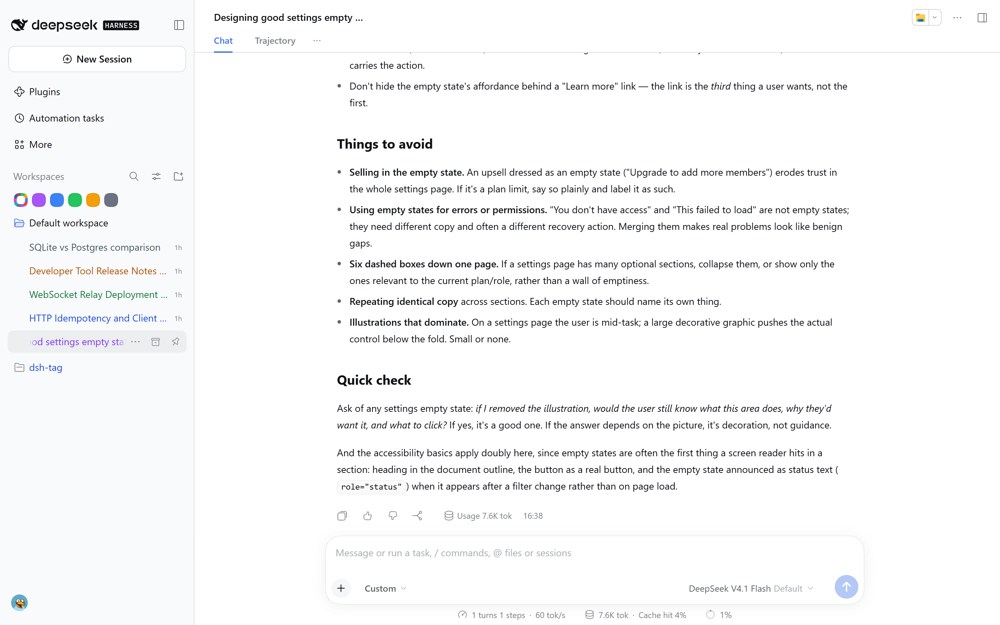

# dsh-tag

English | [中文](README.zh.md) | [日本語](README.ja.md)

Color tags for DeepSeek Harness sessions and workspaces: one tag per row, the title takes its color, and the bar above the workspace list filters by tag.

- One tag per session or workspace; a workspace tag covers its whole group
- Click a color to filter; matching groups open with a count, empty groups hide
- Settings → Tags: rename, recolor, delete, add. Up to 10 tags, one color each
- Turn the filter bar off if you don't use it

## Install

Plugins → Add plugin → `dsh-tag`

API, colors, compatibility and development: [docs/REFERENCE.md](https://github.com/ada87/dsh-tag/blob/main/docs/REFERENCE.md).

MIT
