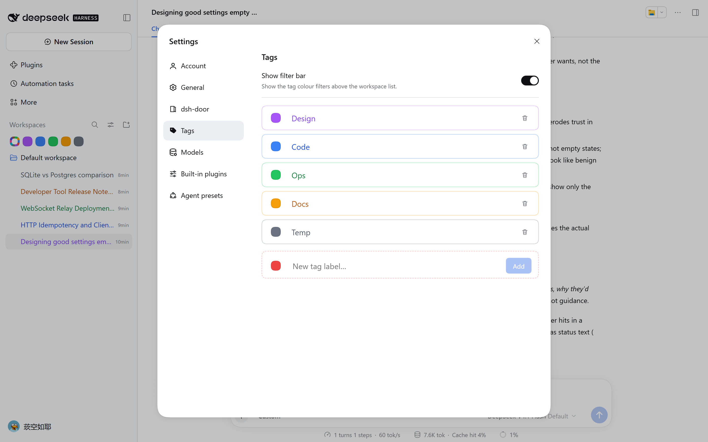

# DSH Tag

English | [中文](README.zh.md) | [日本語](README.ja.md) | [Español](README.es.md) | [Français](README.fr.md) | [Deutsch](README.de.md) | [Русский](README.ru.md) | [Português](README.pt.md)

Color tags for DeepSeek Harness sessions and workspaces: one tag per row, the title takes its color, and the bar above the workspace list filters by tag.

## Install

Plugins → Add plugin → `dsh-tag@0.1.2`

## Use

- Right-click a session or a workspace header → **Tags** → pick a color
- A workspace tag covers its whole group
- Click a color above the workspace list to filter; matching groups open with a count
- Settings → **DSH Tag**: rename, recolor, delete, add. Up to 10 tags, one color each
- Turn the filter bar off if you don't use it
- Unread sessions are shown in bold; opening one clears it, and the same weight reaches the phone

API, colors, compatibility and development: [docs/REFERENCE.md](https://github.com/ada87/dsh-tag/blob/main/docs/REFERENCE.md).

MIT
