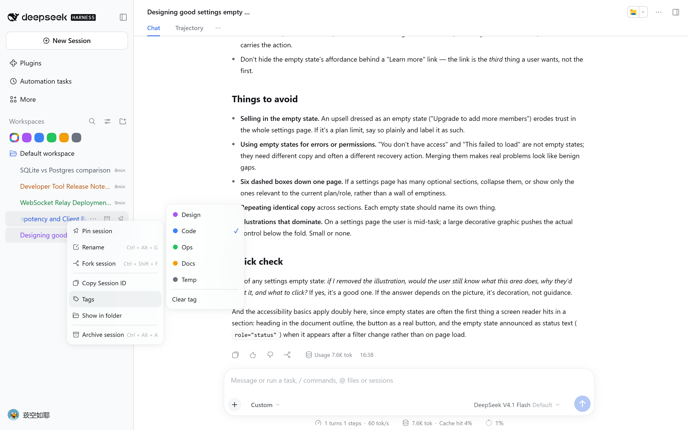
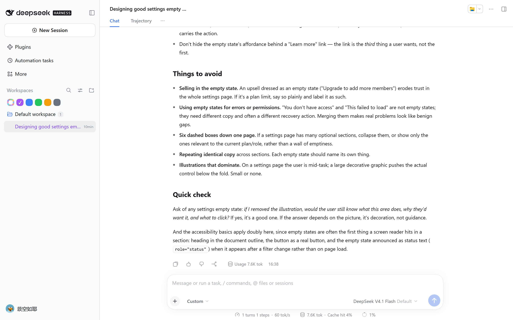

<p align="center"></p>

# dsh-tag

[English](README.md) | 中文 | [日本語](README.ja.md)

   

给 [DeepSeek Harness](https://github.com/deepseek-ai/deepseek-harness) 的会话和工作区加彩色标签。右键打标签，标题跟着变色；点一下侧边栏上方的色条，就只看这个标签下的会话。


## 功能

### 一个会话一个标签，一个标签一种颜色

右键会话（或用行尾的 `...` 菜单）选一个标签。每行只保留一个：选别的会替换，再点当前标签就清除。标题用标签色，悬停时在圆点旁显示标签名。

工作区同理。标在工作区上的标签覆盖整组，这也是过滤条一键带出整组会话的依据。



### 为侧边栏设计的过滤条

标签多了以后，工作区列表上方的色条就是最快的方式：

- 点某个颜色，只看带这个标签的会话
- 标在工作区上的标签会带出整组；匹配的工作区自动展开，并显示命中数量
- 没有命中的工作区直接隐藏，结果像一份列表，而不是一棵要自己展开的树
- 再点同一个颜色，或点七彩的「全部」，恢复原状，包括过滤过程中自动展开的分组



不想要这条色条？在 设置 → 标签 里关掉「显示过滤条」。这个设置存在服务端，所有客户端看到的侧边栏一致。关闭时会顺带清掉正在生效的过滤，避免出现「列表被隐藏但找不到过滤条」的死状态。

### 设置页不抢戏

设置 → 标签 是一列卡片：原地改名、从还没被占用的颜色里换色、删除前确认一次，或者在底部新建。

- 最多 10 个标签，颜色互不重复
- 已被占用的颜色不会出现在选择器里
- 卡片边框就是标签色：平时淡化，编辑时加深
- 满 10 个后，底部的添加行自动消失


### 亮色、暗色都看得清

标题文字没有直接套 500 级填充色，而是每个颜色准备了两套值：亮色主题最低 4.8:1，暗色主题 6.1:1。切换主题时标题和设置文字自动换色，不用重新加载。

### 数据共享，不锁在浏览器里

- 状态保存在 `<DSH_HOME>/state/dsh-tag.json`
- 多个窗口、设备通过 SSE 实时同步
- `GET /tags` 公开只读，App 或其它插件可以渲染同一套标签

## 安装

**插件中心（npm 发布后）**

设置 → 插件 → 添加插件，输入 `dsh-tag`，安装并启用。

**命令行安装到 DSH Web**

```sh
npx @deepseek-ai/dsh@0.2.2-rc.1 plugin --profile web add dsh-tag
npx @deepseek-ai/dsh@0.2.2-rc.1 web
```

**从本地目录安装**

```sh
npx @deepseek-ai/dsh@0.2.2-rc.1 plugin --profile web add /absolute/path/to/dsh-tag
```

安装或重新构建后，用 `Ctrl+Shift+R` 硬刷新 Web UI。

## 使用

1. **给会话打标签** — 右键会话行，或点 `...` → **标签** → 选颜色。前面有勾的就是当前标签，再点一次清除。
2. **给工作区打标签** — 右键工作区标题 → **工作区标签**，整组都会带上颜色。
3. **过滤** — 点色条上的圆点。命中的工作区自动展开并显示数量，空分组隐藏；点「全部」恢复。
4. **管理** — 设置 → 标签。删除标签会同时清掉它在所有会话和工作区上的标记。

## 颜色

| 名称 | 色值 | 名称 | 色值 |
|---|---|---|---|
| `green` | `#22C55E` | `amber` | `#F59E0B` |
| `blue` | `#3B82F6` | `red` | `#EF4444` |
| `purple` | `#A855F7` | `gray` | `#6B7280` |
| `teal` | `#06B6D4` | `pink` | `#EC4899` |
| `indigo` | `#4F46E5` | `brown` | `#8D5B3E` |

10 个色相尽量拉开，蓝 / 靛 / 紫还额外用明度区分。色块和过滤条使用固定 hex；标题文字和卡片边框跟随主题。

## API

所有路径都在 `/tags` 下，没有 `/session-tags`。

| 方法 | 路径 | 说明 |
|---|---|---|
| GET | `/tags` | 完整快照（公开读） |
| GET | `/tags/events` | SSE：连接时推全量，变更再推 |
| GET | `/tags/health` | 能力探测 |
| POST | `/tags` | 新建标签 `{ label, color }` |
| PATCH | `/tags/settings` | 界面偏好 `{ showFilter?: boolean }` |
| PATCH | `/tags/:id` | 改名 / 换色 / 排序 `{ label?, color?, order? }` |
| DELETE | `/tags/:id` | 删除标签并清空关联 |
| PUT | `/tags/sessions/:id` | `{ tagId: string \| null }` |
| PUT | `/tags/workspaces/:id` | `{ tagId, path? }` |

读接口公开；写接口要求同源请求、loopback 地址，或 dsh 已认证连接。

```json
{
  "version": 2,
  "updatedAt": 1760000000000,
  "settings": { "showFilter": true },
  "tags": [
    { "id": "design", "label": "设计", "color": "purple", "order": 10 },
    { "id": "code", "label": "编码", "color": "blue", "order": 20 }
  ],
  "sessions": { "session-xxx": "design" },
  "workspaces": [
    { "id": "workspace-id", "path": "D:\\work\\demo", "tagId": "code" }
  ]
}
```

## 兼容性

```json
"engines": { "dsh": ">=0.2.2-rc.1 <0.3.0" }
```

dsh 会按 semver（含 prerelease）校验这个字段，不满足直接拒绝加载，所以它是硬门槛；下限就是实际开发和验证用的版本。

依赖的大头在浏览器侧，而不是 Host：`locale`、`contextMenus`、`slots`，加上用于级联过滤的 `workspaces` / `sessions` 快照。标题着色和过滤还依赖内部 DOM 属性（`data-row-key`、`[class*="_title"]`）。可选服务缺失时，过滤退化为只筛当前渲染行；槽位不存在时，对应入口直接不出现。

0.2.1 还没有设置项图标的槽位，语言目录也只有 `zh` / `en`，所以下限没有再往下放。升级 dsh 后重点回归：标题着色、过滤条挂载、设置页、语言切换。

## 多语言

界面内置 **English、简体中文、日本語、Español、Français、Deutsch、Русский、Português**。字典通过 `ctx.locale.register` 注册，缺 key 时逐条回落到英文。首次创建状态文件时，默认标签会跟随 Host 语言生成，之后可以随意改名。

## 开发

```sh
npm install
npm run build      # tsc + esbuild + 客户端语法检查
npm run typecheck
npm run test:host  # 临时 DSH_HOME 的 /tags 冒烟测试
```

```
cordis.patch.yml   bundle 插入行
src/index.ts       Host：/tags 路由、SSE、鉴权
src/store.ts       JSON 状态、设置、默认标签
src/protocol.ts    线协议
client/client.js   浏览器半：着色、菜单、过滤条、设置页、8 种语言字典
locale/*.json      插件列表文案
```

已知边界：

- 标题着色依赖 dsh 的 `[class*="_title"]` CSS Modules 命名
- 归档会话保持灰色
- 搜索结果行没有 `data-row-key`，不会着色，也不会被过滤
- 「Ungrouped」组没有 workspaceId，不能打标签

## License

MIT
