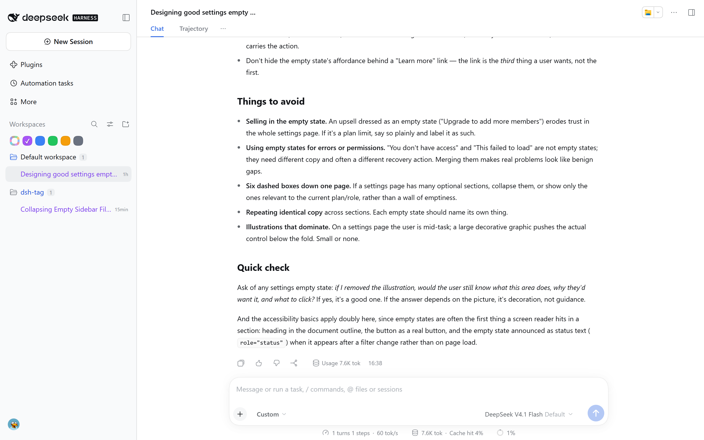
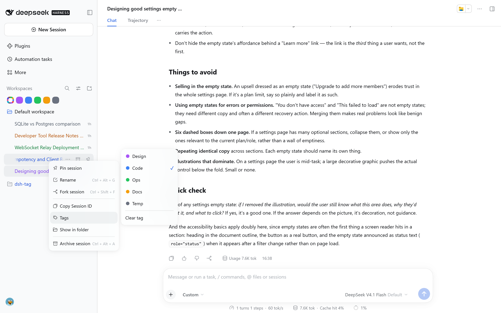

# dsh-tag reference

## Behavior

One tag per session or workspace. Picking another replaces it; picking the checked one clears it. A tag on a workspace covers its whole group, which is what the filter uses.

The filter bar sits above the workspace list:

- Click a color to show only sessions carrying that tag
- A workspace tag brings out its whole group; matching groups open automatically and show the count
- Groups with no matches are hidden
- Click the same color again, or the rainbow **All**, to restore everything, including groups the filter opened





Settings → Tags is a card list: rename inline, recolor from unused colors, delete with one confirmation, add at the bottom. Up to 10 tags, each with a unique color. **Show filter bar** hides the bar and clears any active filter.

State lives in `<DSH_HOME>/state/dsh-tag.json`; windows and devices sync over SSE.

## Colors

| Name | Hex | Name | Hex |
|---|---|---|---|
| `green` | `#22C55E` | `amber` | `#F59E0B` |
| `blue` | `#3B82F6` | `red` | `#EF4444` |
| `purple` | `#A855F7` | `gray` | `#6B7280` |
| `teal` | `#06B6D4` | `pink` | `#EC4899` |
| `indigo` | `#4F46E5` | `brown` | `#8D5B3E` |

Swatches and the filter bar use these fixed values. Title text uses a separate pair per theme (light ≥ 4.8:1, dark ≥ 6.1:1) and switches with the theme without a reload.

## API

Everything sits under `/tags`; there is no `/session-tags`.

| Method | Path | Purpose |
|---|---|---|
| GET | `/tags` | Full snapshot (public) |
| GET | `/tags/events` | SSE: snapshot on connect, then on every change |
| GET | `/tags/health` | Capability probe |
| POST | `/tags` | Create `{ label, color }` |
| PATCH | `/tags/settings` | Interface preferences `{ showFilter?: boolean }` |
| PATCH | `/tags/:id` | Rename / recolor / reorder `{ label?, color?, order? }` |
| DELETE | `/tags/:id` | Delete the tag and clear its assignments |
| PUT | `/tags/sessions/:id` | `{ tagId: string \| null }` |
| PUT | `/tags/workspaces/:id` | `{ tagId, path? }` |

Reads are public. Writes require a same-origin browser request, a loopback address, or an authenticated DSH connection.

```json
{
  "version": 2,
  "updatedAt": 1760000000000,
  "settings": { "showFilter": true },
  "tags": [
    { "id": "design", "label": "Design", "color": "purple", "order": 10 },
    { "id": "code", "label": "Code", "color": "blue", "order": 20 }
  ],
  "sessions": { "session-xxx": "design" },
  "workspaces": [
    { "id": "workspace-id", "path": "D:\\work\\demo", "tagId": "code" }
  ]
}
```

## Compatibility

```json
"engines": { "dsh": ">=0.2.2-rc.1 <0.3.0" }
```

DSH enforces this field through semver (prereleases included), so it is a real gate. The floor is the version this plugin is developed and tested against.

Most of the coupling is in the browser side: `locale`, `contextMenus`, `slots`, and the `workspaces` / `sessions` snapshots for the cascade filter. Title coloring and filtering also depend on internal DOM attributes (`data-row-key`, `[class*="_title"]`). When the optional services are missing, the filter degrades to the rows currently rendered; when a slot is absent, that entry never appears.

0.2.1 does not have the settings icon slot and only ships `zh` / `en` UI catalogs, which is why the floor is not lower. After upgrading DSH, re-check title coloring, filter mounting, the settings page, and language switching.

## Languages

The UI ships with English, 简体中文, 日本語, Español, Français, Deutsch, Русский and Português. Dictionaries register through `ctx.locale.register` and fall back to English key by key. Default tag labels follow the host language on first run.

## Development

```sh
npm install
npm run build      # tsc + esbuild + client syntax check
npm run typecheck
npm run test:host  # /tags smoke test against a temporary DSH_HOME
```

```
cordis.patch.yml   bundle insert
src/index.ts       host: /tags routes, SSE, auth
src/store.ts       JSON state, settings, default tags
src/protocol.ts    wire contract
client/client.js   browser half: coloring, menus, filter, settings, 8 dictionaries
locale/*.json      plugin listing copy
```

Known limits:

- Title coloring relies on DSH's `[class*="_title"]` CSS module convention
- Archived sessions stay gray
- Search result rows have no `data-row-key`, so they are neither colored nor filtered
- The ungrouped group has no workspace id and cannot be tagged

## License

MIT
